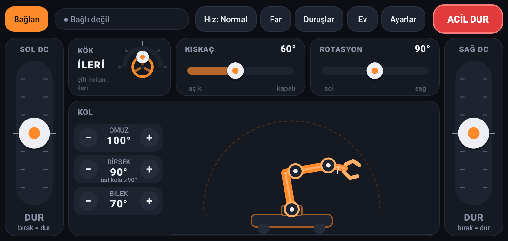
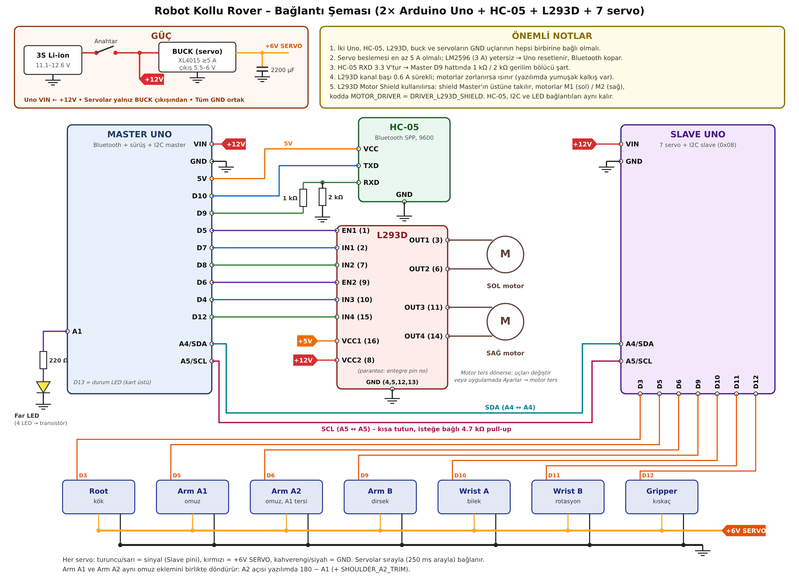

# Robot Kollu Rover – Android Kumanda + Arduino Firmware

7 servolu robot kollu, 2 DC motorlu rover için:
- **Android uygulaması** (Kotlin, HC-05 klasik Bluetooth)
- **Master Uno** firmware'i: Bluetooth + L293D motor sürme + güvenlik
- **Slave Uno** firmware'i: 7 servo, yumuşak hareket, ayna omuz (A1/A2)



**📘 Ayrıntılı proje özeti (tüm özellikler, protokol, testler, riskler):** [docs/PROJE_OZETI.md](docs/PROJE_OZETI.md)

**Bağlantı şeması:** [docs/baglanti_semasi.png](docs/baglanti_semasi.png) (vektör: [SVG](docs/baglanti_semasi.svg))



Ayrıntılı plan, pin tabloları, protokol ve tespit edilen donanım riskleri: **[docs/PLAN.md](docs/PLAN.md)**

## Klasörler

| Yol | İçerik |
|---|---|
| `release/RobotKolRover-v1.1.apk` | Telefona kurulacak hazır APK |
| `firmware/rover_master/` | Master Uno (HC-05, L293D, I2C master) |
| `firmware/rover_slave/` | Slave Uno (7 servo, I2C slave 0x08) |
| `android/` | Android Studio / Gradle projesi |
| `docs/PROJE_OZETI.md` | Tüm çalışmanın ayrıntılı yazılı özeti |
| `docs/` | Plan, bağlantı şeması (PNG/SVG), ekran görüntüleri |
| `tools/baglanti_semasi_uret.py` | Şemayı yeniden üreten betik (`python3 tools/baglanti_semasi_uret.py docs/baglanti_semasi.svg`) |

## Hızlı başlangıç

1. **Slave Uno**'ya `firmware/rover_slave/rover_slave.ino` yükleyin (kütüphane: *Servo*).
2. **Master Uno**'ya `firmware/rover_master/rover_master.ino` yükleyin.
   L293D **Motor Shield** kullanıyorsanız dosyanın başında
   `#define MOTOR_DRIVER DRIVER_L293D_SHIELD` yapın (varsayılan: çıplak L293D entegresi).
3. Kabloları [docs/PLAN.md §3](docs/PLAN.md#3-bağlantı-tablosu) tablosuna göre bağlayın.
   Unutmayın: iki Uno'nun GND'si ortak, HC-05 RX hattında 1k/2k bölücü, servolar ayrı güçlü beslemede.
4. Telefonda Bluetooth ayarlarından **HC-05**'i eşleştirin (PIN: 1234 veya 0000).
5. `release/RobotKolRover-v1.1.apk` dosyasını telefona kurun ("bilinmeyen kaynaklar" izni gerekebilir),
   uygulamada **Bağlan** → HC-05'i seçin. Üst çubukta "Kol ● hazır" görünmelidir.

## Arayüz

| Kontrol | Ne yapar |
|---|---|
| **SOL DC / SAĞ DC** | Dikey sürgüler, tank sürüşü. Bırakınca otomatik durur. İki başparmakla aynı anda kullanılır. |
| **Çevrilebilir kök** | Direksiyon gibi döndürün → kök servosu. Çift dokunma: ileri (90°). |
| **Kıskaç** | Aç / kapa sürgüsü. |
| **Sağ / sol rotasyon** | Bilek dönüşü (Wrist B). Çift dokunma: ortala. |
| **Etkileşimli kol** | Üst kol / ön kol / eli sürükleyin. **Yalnız o eklem döner**, sonraki segmentler ona bağlı taşınır (ileri kinematik; tüm kol ters kinematikle oynamaz). |
| **Hız** | Servo hareket hızı: Yavaş 45°/s, Normal 90°/s, Hızlı 160°/s |
| **Duruşlar** | Hazır referans duruşlar + mevcut duruşu kaydetme (uzun bas: sil), "Şu anki açılar" ile servo değerlerini görme |
| **Ayarlar** | Ters takılmış servo/motor yönlerini çevirme |
| **ACİL DUR** | Motorlar anında durur, kol olduğu yerde kilitlenir |

Bağlantı koparsa master 600 ms içinde motorları durdurur.

## Referans duruşlar (servo açıları)

Sıra: Kök, Omuz (A1; A2 = 180 − A1), Dirsek, Bilek, Rotasyon, Kıskaç

| Duruş | Açılar |
|---|---|
| Ev / Park | 90, 100, 90, 70, 90, 60 |
| Kalibrasyon (hepsi 90°) | 90, 90, 90, 90, 90, 90 |
| Öne uzan | 90, 30, 180, 90, 90, 30 |
| Yerden al | 90, 45, 110, 50, 90, 30 |
| Kavra | 90, 45, 110, 50, 90, 105 |
| Taşıma | 90, 120, 120, 60, 90, 105 |
| Sola bak / Sağa bak | 150 / 30, 100, 150, 80, 90, 60 |

Dirsek: pivot üst kolun ucundaki sağa çıkıntıda; 90 = ön kol üst kola ≈90° (sağa), 0 = aşağı katlanmış paralel (çarpışmasız), 180 = düz devam.
Bunlar sahada test edilip düzeltilecek başlangıç değerleridir.

## İlk çalıştırma ve kalibrasyon kontrol listesi

1. Kol **mekanik olarak takılmadan** slave'i çalıştırın: tüm servolar ev açısına gider.
   Uygulamadan **Kalibrasyon (hepsi 90°)** duruşunu seçip servo kollarını (horn) bu konumda takın.
2. Omuz A1/A2: iki servo aynı yöne kaldırmalı. Zorlanma/ısınma varsa `rover_slave.ino` içindeki
   `SHOULDER_A2_TRIM` değerini birkaç derece değiştirin.
3. Mekanik sınırlar: `JOINT_MIN` / `JOINT_MAX` dizilerini daraltın (uygulamadaki `Joint.kt` ile aynı tutun).
4. Bir eklem arayüzdekinin tersine dönüyorsa: **Ayarlar** → o servoyu "ters" işaretleyin.
5. Rover ileri yerine geri gidiyorsa: **Ayarlar** → "Sol/Sağ motor ters".

## Derleme

```bash
# Firmware (arduino-cli)
arduino-cli compile -b arduino:avr:uno firmware/rover_slave
arduino-cli compile -b arduino:avr:uno firmware/rover_master

# Android (JDK 17+, Android SDK 34)
cd android
./gradlew testDebugUnitTest   # protokol, kinematik ve ekran testleri
./gradlew assembleRelease     # app/build/outputs/apk/release/app-release.apk
```

APK, yan yükleme için Android debug anahtarıyla imzalıdır (Play Store için değil).
