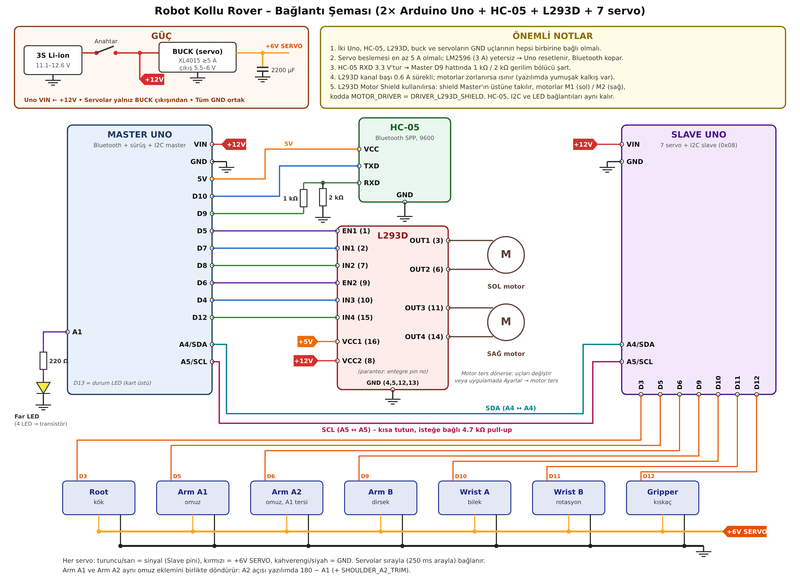

# Robot Kollu Rover – Plan ve Proje Şeması

> Tüm çalışmanın ayrıntılı özeti: [PROJE_OZETI.md](PROJE_OZETI.md)

## 1. Elimizdeki donanım

| Parça | Adet | Not |
|---|---|---|
| Arduino Uno | 2 | Master (iletişim + sürüş), Slave (servolar) |
| HC-05 Bluetooth | 1 | Klasik Bluetooth (SPP) → yalnız Android |
| L293D | 1 | Çıplak entegre/modül **veya** L293D Motor Shield (ikisi de destekleniyor) |
| DC motor (JGB37-520 tipi) | 2 | Sol / sağ tekerlek (tank sürüşü) |
| Servo | 7 | Root, Arm A1, Arm A2, Arm B, Wrist A, Wrist B, Gripper |
| 3S Li-ion pil (12 V) + anahtar + buck | – | PDF'teki güç yapısı |

PDF'teki şemadan **çıkanlar:** Arduino Mega, NRF24L01, kumanda (joystick, pot, anahtarlar), L298N.

## 2. Mimari

```
 ┌─────────────┐  Bluetooth SPP   ┌──────────────────────────┐   I2C (A4/A5)   ┌──────────────────────────┐
 │ Android App │ ───────────────► │  MASTER UNO              │ ──────────────► │  SLAVE UNO               │
 │  (Kotlin)   │ ◄─────────────── │  HC-05 (SoftwareSerial)  │ ◄────────────── │  7 servo (Servo.h)       │
 └─────────────┘   telemetri      │  L293D → 2 DC motor      │   açı geri bildirimi │  yumuşak hareket (rampa) │
                                  │  güvenlik zamanlayıcısı  │                 │  A2 = 180 - A1 (ayna)    │
                                  └──────────────────────────┘                 └──────────────────────────┘
```

**Neden bu bölüşüm?**
- `SoftwareSerial` alım sırasında kesmeleri kapatır → aynı kartta servolar titrer. HC-05 ile servolar ayrı kartta.
- `Servo.h` Timer1'i kullanır; Uno'da 12 servoya kadar sürer → 7 servo tek slave'de rahat.
- Motorların PWM'i (Timer0/Timer2) master'da; Servo kütüphanesiyle çakışmaz.
- I2C (Wire) 2 kart arası en az kablo (SDA, SCL, GND) ve çift yönlü.

## 3. Bağlantı tablosu

Görsel şema: [baglanti_semasi.png](baglanti_semasi.png) · [SVG](baglanti_semasi.svg)



### Master Uno
| Uno pini | Bağlantı |
|---|---|
| D10 | HC-05 **TXD** (SoftwareSerial RX) |
| D9 | 1 kΩ → HC-05 **RXD**, ayrıca 2 kΩ → GND (5 V → 3.3 V bölücü) |
| 5V / GND | HC-05 VCC / GND |
| A4 (SDA) | Slave A4 |
| A5 (SCL) | Slave A5 |
| GND | Slave GND (**ortak toprak şart**) |
| A1 | Far LED'leri (220 Ω ile, 4 LED için transistör önerilir) |
| D13 | Durum LED'i (kart üstü) – bağlantı varken yanar |

**Mod A – çıplak L293D entegresi / modülü** (`MOTOR_DRIVER = DRIVER_L293D_IC`)
| Uno | L293D pini |
|---|---|
| D5 (PWM) | 1 – EN1,2 (sol motor hız) |
| D7 | 2 – IN1 |
| D8 | 7 – IN2 |
| D6 (PWM) | 9 – EN3,4 (sağ motor hız) |
| D4 | 10 – IN3 |
| D12 | 15 – IN4 |
| – | 3/6 → sol motor, 11/14 → sağ motor |
| 5 V | 16 – VCC1 (lojik) |
| Pil 12 V | 8 – VCC2 (motor) |
| GND | 4, 5, 12, 13 |

**Mod B – L293D Motor Shield (v1)** (`MOTOR_DRIVER = DRIVER_L293D_SHIELD`)
Shield doğrudan master Uno'nun üstüne takılır. Sol motor **M1**, sağ motor **M2** klemensine.
Shield D3, D4, D7, D8, D11, D12'yi kullanır; D9/D10 (HC-05), A1, A4/A5 boş kalır.
Motor gücü shield'in EXT_PWR klemensine, PWR jumper'ı **çıkarılmış** olarak.

### Slave Uno
| Uno pini | Servo |
|---|---|
| D3 | Root (kök dönüşü) |
| D5 | Arm A1 (omuz) |
| D6 | Arm A2 (omuz, A1'in tersi) |
| D9 | Arm B (dirsek) |
| D10 | Wrist A (bilek yukarı/aşağı) |
| D11 | Wrist B (bilek sağ/sol rotasyon) |
| D12 | Gripper (kıskaç) |
| A4 / A5 | Master A4 / A5 |

Servo sinyal kabloları slave'e, **servo + / – uçları ayrı güçlü 5–6 V hattına** gider (bkz. §6).

## 4. Haberleşme protokolü

### Telefon → Master (Bluetooth, 9600 baud, ASCII çerçeve)

Her çerçeve `<GÖVDE*CS>` biçimindedir; `CS` = GÖVDE karakterlerinin XOR'u, 2 haneli hex.
Örnek: `<D,120,-80*1E>`. Sağlama toplamı tutmayan çerçeve atılır (SoftwareSerial gönderim yaparken
gelen baytlar bozulabildiği için gerekli). Aşağıdaki tabloda yalnız GÖVDE gösterilmiştir.

| Komut | Anlam |
|---|---|
| `<D,l,r>` | Sürüş: l, r ∈ [-255, 255] |
| `<J,r,s,e,p,w,g>` | Kol pozu (derece 0–180): root, omuz, dirsek, bilek, rotasyon, kıskaç |
| `<V,n>` | Servo hızı (derece/saniye, 10–250) |
| `<L,0/1>` | Far |
| `<Z>` | Ev pozisyonu |
| `<X>` | Acil dur: motorlar durur, servolar olduğu yerde kalır |
| `<H>` | Kalp atışı |
| `<?>` | Merhaba → master `<OK,ROVER,1*CS>` döner |

Uygulama sürüş sırasında 20 Hz, boşta 4 Hz paket yollar. **Master 600 ms paket almazsa motorları durdurur.**

### Master → Telefon
`<T,k,r,s,e,p,w,g*CS>` her 400 ms: k = slave bağlı mı (0/1), ardından servoların gerçek (rampalı) açıları.
Uygulama bağlanınca ilk telemetriyle kol çizimini gerçek poza eşitler.

### Master ↔ Slave (I2C, adres 0x08)
| Kayıt | Veri |
|---|---|
| 0x01 POSE | 6 bayt açı |
| 0x02 SPEED | 1 bayt (derece/s) |
| 0x03 HOME | – |
| 0x04 FREEZE | – (hedef = mevcut açı) |
| okuma (8 bayt) | 0xA5, bayrak, 6 mevcut açı |

## 5. Uygulama arayüzü (yatay ekran)

```
┌──────────────────────────────────────────────────────────────────────────┐
│ [Bağlan] HC-05 ● bağlı   Slave ●   [Hız: Normal] [Far] [Ev] [ACİL DUR]  │
├──────┬───────────────────────────────────────────────────────────┬──────┤
│      │        ( çevrilebilir kök )           kıskaç  ═══●══════   │      │
│ SOL  │          direksiyon çarkı              rotasyon ═════●═══   │ SAĞ  │
│ DC   │                                                            │ DC   │
│  ║   │                  ○──────○ (el)                             │  ║   │
│  ●   │                 /                                          │  ●   │
│  ║   │        ○───────○  ← etkileşimli kol (yandan görünüş)        │  ║   │
│      │       ▀▀▀▀                                                │      │
└──────┴───────────────────────────────────────────────────────────┴──────┘
```

- **Sol / sağ DC:** dikey sürgü, bırakınca **otomatik 0'a döner** (güvenlik). Çoklu dokunma: iki başparmakla tank sürüşü.
- **Çevrilebilir kök:** çark parmakla döndürülür, bırakılınca yerinde kalır (±90°).
- **Etkileşimli kol:** omuz, dirsek ve bilek segmentlerinden birine dokunup sürükleyin.
  Her segment **kendi ekleminin etrafında, bir önceki segmente göre** döner; sonraki segmentler ona yapışık taşınır
  (ileri kinematik – tüm kolu aynı anda hareket ettiren ters kinematik **yok**).
- **Rotasyon sürgüsü:** bilek sağ/sol (Wrist B). **Kıskaç sürgüsü:** aç/kapa.

Açı ↔ çizim eşlemesi:
- omuz mutlak açısı = servo açısı (90 = dik, 0 = ileri yatay)
- dirsek göreli açısı = servo − 90 (90 = düz devam)
- bilek göreli açısı = servo − 90

## 6. Tespit edilen sorunlar / riskler

1. **Servo güç bütçesi (en kritik).** 7 adet MG996R sınıfı servo zorlanınca her biri 1.5–2.5 A çeker.
   PDF'teki LM2596 tipi buck en fazla ~3 A verir → gerilim çöker, **Uno'lar resetlenir, HC-05 kopar**.
   Öneri: servolar için en az **5 A** (XL4015/XL4016 veya 2 ayrı buck: omuz çifti + diğerleri), çıkışa 1000–2200 µF kondansatör.
   Arduino'lar servo hattından değil, ayrı beslensin (VIN ← pil, ya da ayrı küçük 5 V buck). Tüm GND'ler ortak.
2. **L293D akım sınırı.** Kanal başına 0.6 A sürekli / 1.2 A tepe. JGB37-520 motorlar kalkışta ve zorlanınca 1 A'yı aşar →
   ısınma/termal kapanma. L293D ayrıca ~2–3 V düşürür (12 V → motora ~9.5 V). Hafif rover için çalışır; ağır yükte
   TB6612FNG veya L298N tavsiye edilir. Yazılımda yumuşak kalkış (rampa) ile tepe akımı düşürüldü.
3. **HC-05 RX 3.3 V'tur** → master TX hattında 1k/2k bölücü şart.
4. **Açılışta servo sıçraması.** Servolar güç gelince bilinmeyen konumdan ev pozisyonuna atlar; yazılım servoları
   sırayla (250 ms arayla) bağlar ki ani akım darbesi azalsın.
5. **A1/A2 ayna kalibrasyonu.** İki servo mekanik olarak tam simetrik takılmazsa birbirine karşı zorlanır, ısınır.
   `slave.ino` içindeki `SHOULDER_A2_TRIM` ile sıfırlayın; ilk denemede kolu bağlamadan servoları 90°'de takın.
6. **3S pil 12.6 V'a kadar çıkar;** Uno VIN için sınırda ama kabul edilebilir (regülatör ısınır).
   Daha temiz çözüm: ayrı 7–9 V veya 5 V buck.
7. **Bağlantı koparsa:** motorlar 600 ms içinde durur, kol olduğu yerde kalır.

## 7. Yol haritası

- [x] 1. Şema ve gereksinim analizi, sorunların tespiti
- [x] 2. Protokol ve pin planı (bu belge)
- [x] 3. Slave firmware: servo sürme, rampa, ayna omuz, I2C
- [x] 4. Master firmware: HC-05 ayrıştırıcı, L293D (iki mod), watchdog, I2C köprü, telemetri
- [x] 5. Android: Bluetooth SPP bağlantısı, protokol
- [x] 6. Android: özel kontroller (DC sürgüler, kök çarkı, etkileşimli kol, sürgüler)
- [x] 7. Derleme/test (firmware: arduino-cli; Android: 15 birim + ekran testi, APK `release/` altında)
- [ ] 8. Sahada kalibrasyon (açı sınırları, yönler, trim) – donanımla sizin yapmanız gereken adım
