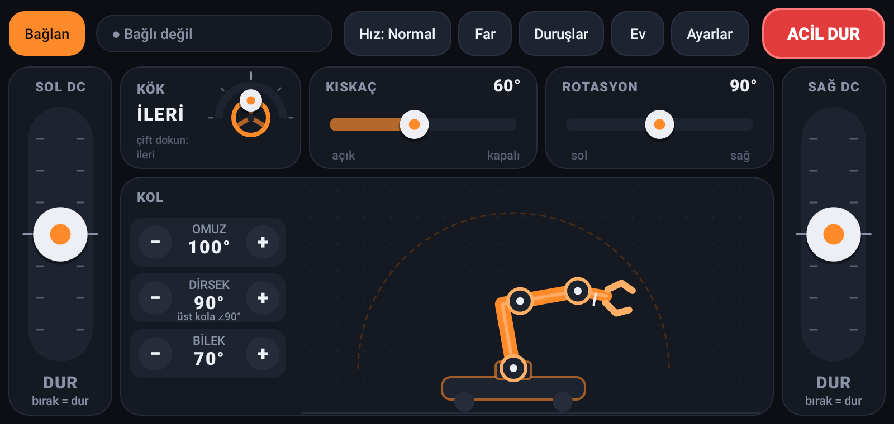
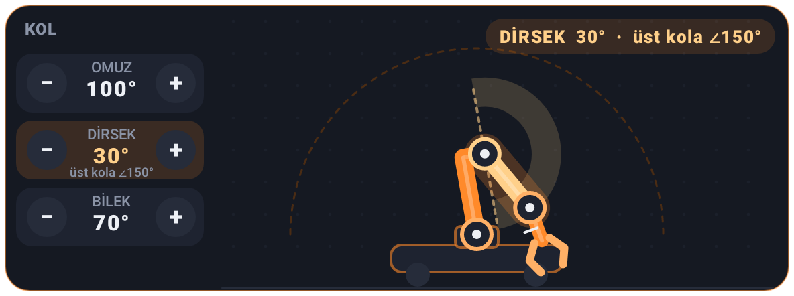
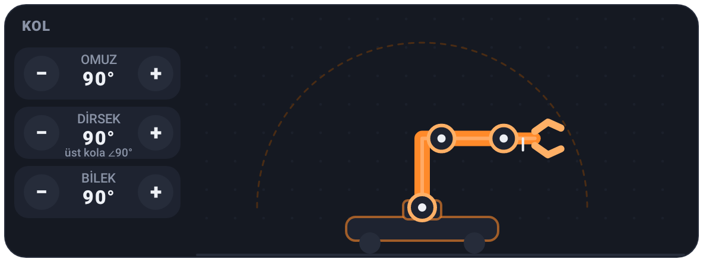
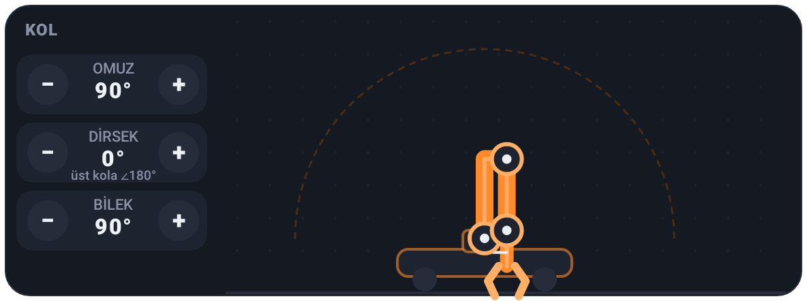

# Robot Kollu Rover – Proje Özeti (Ayrıntılı)

Bu belge, projede yapılan tüm çalışmayı tek yerde toplar: amaç, donanım kararları, mimari, firmware'ler,
haberleşme protokolü, Android uygulamasının her özelliği, testler, derleme/kurulum, bilinen riskler ve sonraki adımlar.

> Kısa giriş için: [README.md](../README.md) · Pin tabloları ve plan: [PLAN.md](PLAN.md) · Görsel şema: [baglanti_semasi.png](baglanti_semasi.png)

---

## İçindekiler

1. [Amaç ve kapsam](#1-amaç-ve-kapsam)
2. [Donanım ve orijinal şemadan farklar](#2-donanım-ve-orijinal-şemadan-farklar)
3. [Sistem mimarisi ve tasarım kararları](#3-sistem-mimarisi-ve-tasarım-kararları)
4. [Bağlantılar](#4-bağlantılar)
5. [Master Uno firmware'i](#5-master-uno-firmwarei)
6. [Slave Uno firmware'i](#6-slave-uno-firmwarei)
7. [Haberleşme protokolü (tam tanım)](#7-haberleşme-protokolü-tam-tanım)
8. [Android uygulaması](#8-android-uygulaması)
9. [Kol kinematiği ve açı kuralları](#9-kol-kinematiği-ve-açı-kuralları)
10. [Referans duruşlar](#10-referans-duruşlar)
11. [Güvenlik mekanizmaları](#11-güvenlik-mekanizmaları)
12. [Testler ve doğrulama](#12-testler-ve-doğrulama)
13. [Derleme, kurulum ve yükleme](#13-derleme-kurulum-ve-yükleme)
14. [Kalibrasyon ve saha testi prosedürü](#14-kalibrasyon-ve-saha-testi-prosedürü)
15. [Bilinen riskler ve sınırlamalar](#15-bilinen-riskler-ve-sınırlamalar)
16. [Depo yapısı (dosya dosya)](#16-depo-yapısı-dosya-dosya)
17. [Değişiklik geçmişi ve sonraki adımlar](#17-değişiklik-geçmişi-ve-sonraki-adımlar)

---

## 1. Amaç ve kapsam

7 servolu robot kolu ve 2 DC motoru olan bir rover'ı **Android telefondan Bluetooth ile** kontrol etmek.

Teslim edilenler:

| Bileşen | Durum |
|---|---|
| Android kumanda uygulaması (Kotlin, yerel) | Tamamlandı, APK derlendi |
| Master Arduino Uno firmware'i (Bluetooth + sürüş + köprü) | Tamamlandı, derleniyor |
| Slave Arduino Uno firmware'i (7 servo) | Tamamlandı, derleniyor |
| Plan, pin tabloları, protokol belgesi | `docs/PLAN.md` |
| Görsel bağlantı şeması (PNG + SVG) ve üretici betik | `docs/`, `tools/` |
| Birim testleri + ekran görüntüsü testi | 17 test, hepsi geçiyor |

Kullanıcı gereksinimleri (sohbetten):

- Arayüz, elle çizilen taslaktaki gibi olacak: sol DC, sağ DC, çevrilebilir kök, kıskaç sürgüsü, sağ/sol rotasyon sürgüsü, etkileşimli kol.
- Etkileşimli kolda **her uzantı kendinden bir önceki parçayı referans alarak dönecek**; tüm kol aynı anda ters kinematiğe girmeyecek.
- Arduino Mega yok → **iki Arduino Uno master/slave** olarak çalışacak.
- Orijinal kumanda (joystick'li Uno + NRF24) devre dışı; yerine mobil uygulama.
- Telefon **Android**, modül **HC-05**, sürücü **L293D**, NRF24 **yok**.
- Omuzdaki **Arm A1 ve Arm A2 birbirine zıt çalışacak** (tork için aynı eklemi iki servo döndürüyor).

---

## 2. Donanım ve orijinal şemadan farklar

### Kullanılan donanım

| Parça | Adet | Görev |
|---|---|---|
| Arduino Uno | 2 | Master: Bluetooth + motor + I2C master. Slave: 7 servo + I2C slave |
| HC-05 | 1 | Klasik Bluetooth SPP, 9600 baud |
| L293D | 1 | 2 DC motor sürücü (çıplak entegre/modül **veya** L293D Motor Shield v1) |
| DC redüktörlü motor (JGB37-520 tipi, 12 V) | 2 | Sol ve sağ tekerlek (tank sürüşü) |
| Servo (MG996R sınıfı varsayıldı) | 7 | Root, Arm A1, Arm A2, Arm B, Wrist A, Wrist B, Gripper |
| 3S Li-ion pil (11.1–12.6 V) + anahtar | 1 | Ana güç |
| Buck dönüştürücü (≥5 A, 5.5–6 V önerilir) | 1 | Servo beslemesi |
| LED (far) + 220 Ω | 4 | A1 üzerinden (4 LED için transistör önerilir) |

### Orijinal PDF şemasından farklar

| Orijinal (PDF) | Bu proje |
|---|---|
| Arduino Mega | 2× Arduino Uno (I2C ile master/slave) |
| NRF24L01 + joystick'li kumanda Uno'su | HC-05 + Android uygulaması |
| L298N | L293D (iki bağlantı modu desteklenir) |
| LM2596 tipi buck (≈3 A) | ≥5 A buck önerildi (bkz. §15) |

### Eklem eşlemesi (6 eklem, 7 servo)

| Eklem | Servo(lar) | Slave pini | Açıklama |
|---|---|---|---|
| Kök (Root) | Root | D3 | Kolun taban dönüşü |
| Omuz (Shoulder) | Arm A1 + Arm A2 | D5 + D6 | A2 = 180 − A1 + trim (ayna) |
| Dirsek (Elbow) | Arm B | D9 | |
| Bilek (Wrist pitch) | Wrist A | D10 | Yukarı / aşağı |
| Rotasyon (Wrist roll) | Wrist B | D11 | Sağ / sol dönüş |
| Kıskaç (Gripper) | Gripper | D12 | Aç / kapa |

---

## 3. Sistem mimarisi ve tasarım kararları

```
 ┌─────────────┐  Bluetooth SPP   ┌──────────────────────────┐   I2C (A4/A5)   ┌──────────────────────────┐
 │ Android App │ ───────────────► │  MASTER UNO              │ ──────────────► │  SLAVE UNO               │
 │  (Kotlin)   │ ◄─────────────── │  HC-05 (SoftwareSerial)  │ ◄────────────── │  7 servo (Servo.h)       │
 └─────────────┘   telemetri      │  L293D → 2 DC motor      │  açı geri bildirimi │  hız ayarlı rampa        │
                                  │  güvenlik zamanlayıcısı  │                 │  A2 = 180 − A1 (ayna)    │
                                  └──────────────────────────┘                 └──────────────────────────┘
```

**Neden bu bölüşüm?**

| Karar | Gerekçe |
|---|---|
| Servolar ayrı (slave) kartta | `SoftwareSerial` bayt alırken kesmeleri kapatır; aynı kartta servo darbeleri bozulur ve servolar titrer. |
| HC-05 donanım seri portu (D0/D1) yerine SoftwareSerial (D10/D9) | USB ile kod yüklerken HC-05'i sökmek gerekmez. Yarı çift yönlülük sorunu sağlama toplamıyla çözüldü (§7). |
| Kartlar arası I2C | Yalnız 3 kablo (SDA, SCL, GND), çift yönlü (master servo açılarını geri okuyabiliyor), Uno'da donanım desteği var. |
| Motor PWM'i master'da | Timer0/Timer2 PWM; Servo kütüphanesi (Timer1) ile çakışma yok. |
| Uygulamada AndroidX/AppCompat yok | Sıfır çalışma zamanı bağımlılığı, küçük APK (~650 KB), tüm kontroller özel `View` ile çizildi. |
| İleri kinematik (ters kinematik yok) | Kullanıcı isteği: her segment yalnız kendi ekleminde döner, sonrakiler ona bağlı taşınır. |

---

## 4. Bağlantılar

- Görsel şema: [docs/baglanti_semasi.png](baglanti_semasi.png) / [SVG](baglanti_semasi.svg)
- Tam pin tabloları: [docs/PLAN.md §3](PLAN.md#3-bağlantı-tablosu)

Özet:

| Master Uno | Bağlantı | | Slave Uno | Bağlantı |
|---|---|---|---|---|
| VIN | +12V | | VIN | +12V |
| D10 | HC-05 TXD | | D3 | Root |
| D9 | 1 kΩ → HC-05 RXD (2 kΩ → GND) | | D5 | Arm A1 |
| 5V | HC-05 VCC, L293D VCC1 | | D6 | Arm A2 |
| D5 / D7 / D8 | L293D EN1 / IN1 / IN2 (sol) | | D9 | Arm B |
| D6 / D4 / D12 | L293D EN2 / IN3 / IN4 (sağ) | | D10 | Wrist A |
| A1 | Far LED'i | | D11 | Wrist B |
| A4 / A5 | Slave A4 / A5 | | D12 | Gripper |
| GND | Ortak GND | | GND | Ortak GND |

L293D Motor Shield modunda: shield master'ın üstüne takılır; D3, D4, D7, D8, D11, D12 shield'e aittir,
sol motor **M1**, sağ motor **M2**. HC-05 (D9/D10), LED (A1) ve I2C (A4/A5) değişmez.

Şema yeniden üretilebilir: `python3 tools/baglanti_semasi_uret.py docs/baglanti_semasi.svg`

---

## 5. Master Uno firmware'i

Dosya: [`firmware/rover_master/rover_master.ino`](../firmware/rover_master/rover_master.ino)

### Görevleri

1. HC-05'ten gelen çerçeveleri ayrıştırır, sağlama toplamını doğrular.
2. İki DC motoru L293D üzerinden sürer (rampa ile).
3. Kol komutlarını I2C ile slave'e iletir.
4. Slave'den servo açılarını okur, telefona telemetri olarak yollar.
5. Bağlantı koparsa motorları durdurur.

### Yapılandırma sabitleri (dosyanın başı)

| Sabit | Varsayılan | Anlamı |
|---|---|---|
| `MOTOR_DRIVER` | `DRIVER_L293D_IC` | `DRIVER_L293D_SHIELD` yapılırsa shield (74HC595) sürülür |
| `INVERT_LEFT` / `INVERT_RIGHT` | `false` | Motor yönünü yazılımda ters çevirir |
| `LINK_TIMEOUT_MS` | 600 | Bu süre paket gelmezse motorlar durur |
| `TELEMETRY_MS` | 400 | Telefona telemetri aralığı |
| `RAMP_PER_10MS` | 25 | PWM rampası: 0→255 yaklaşık 100 ms |
| `SLAVE_ADDR` | 0x08 | Slave I2C adresi |

### Ayrıntılar

- **Seri hatlar:** HC-05 `SoftwareSerial(10, 9)` 9600 baud; USB `Serial` 115200 (hata ayıklama: açılışta "Slave bulundu" / "Slave YOK" yazar).
- **Çerçeve ayrıştırıcı:** `<` ile başlar, `>` ile biter, 48 baytlık tampon; taşan çerçeve atılır. Alanlar `strtol` ile okunur, en çok 8 alan.
- **Sağlama toplamı:** `*CS` yoksa ya da tutmazsa çerçeve atılır ve `badFrames` sayacı artar. Bozuk çerçeve güvenlik zamanlayıcısını **yenilemez**.
- **Motor sürme (entegre modu):** IN pinleri yönü, EN pinleri `analogWrite` ile hızı belirler.
- **Motor sürme (shield modu):** 74HC595'e (LATCH D12, CLK D4, ENABLE D7, DATA D8) yön bitleri kaydırılır; PWM M1 = D11, M2 = D3.
- **Rampa:** Her 10 ms'de çıkış hedefe en çok 25 adım yaklaşır. **Yön değişiminde önce 0'a inilir** (H-köprüsünü ve L293D'yi tepe akımdan korur).
- **I2C:** 100 kHz; çekirdek destekliyorsa `Wire.setWireTimeout(3000 µs)` ile slave takılırsa master kilitlenmez.
- **Açılış:** Pinler güvenli konuma alınır, motorlar durdurulur, slave'in servoları sırayla bağlaması için 2 s beklenir, slave yoklanır.
- **Durum LED'i (D13):** Telefondan düzenli paket gelirken yanar.
- **Far (A1):** `<L,1>` / `<L,0>`.
- **Bellek:** Flash ≈ 9.6 KB (%29), RAM 643 B (%31). Shield modunda ≈ 9.7 KB.

---

## 6. Slave Uno firmware'i

Dosya: [`firmware/rover_slave/rover_slave.ino`](../firmware/rover_slave/rover_slave.ino)

### Yapılandırma sabitleri

| Sabit | Değer | Anlamı |
|---|---|---|
| `JOINT_MIN` | 0, 15, 0, 0, 0, 20 | Eklem alt sınırları (kök, omuz, dirsek, bilek, rotasyon, kıskaç) |
| `JOINT_MAX` | 180, 165, 180, 180, 180, 110 | Eklem üst sınırları |
| `JOINT_HOME` | 90, 100, 50, 70, 90, 60 | Açılış / ev pozisyonu |
| `SHOULDER_A2_TRIM` | 0 | A2'nin A1'e göre montaj farkı (derece) |
| `DEFAULT_SPEED` | 90 °/s | Açılış hızı |
| `MIN_SPEED` / `MAX_SPEED` | 10 / 250 °/s | Hız sınırları |

### Ayrıntılar

- **Yumuşak hareket (rampa):** Ana döngü 100 Hz çalışır. Her eklem, hedefine `hız × geçen süre` kadar yaklaşır. Böylece telefondaki ani sürükleme bile servoya yumuşak gider; akım darbeleri azalır.
- **Hassas çıkış:** Açılar `writeMicroseconds` ile yazılır (544–2400 µs aralığı) → ≈0.1° çözünürlük, 1°'lik basamak titremesi yok.
- **Ayna omuz:** Omuz eklemi yazılırken A1 = açı, A2 = 180 − açı + `SHOULDER_A2_TRIM`. İkisi her zaman aynı anda güncellenir.
- **Sıralı bağlama:** Servolar açılışta 250 ms arayla tek tek `attach` edilir; attach'tan **önce** hedef darbe yazılır ki ilk darbe doğru konumda olsun. Aynı anda 7 servonun çektiği akım darbesi önlenir.
- **I2C geri çağrıları (kesme içinde):**
  - `onReceive`: kayda göre hedefleri günceller, sınırlara kırpar, artakalan baytları atar.
  - `onRequest`: 8 bayt durum yollar.
- **Kesme güvenliği:** Kesme içinde `float` okunmaz; döngü her adımda yuvarlanmış açıyı `volatile uint8_t currentByte[]` dizisine yazar, kesme bunu okur (yırtık okuma olmaz).
- **FREEZE (acil dur):** Hedefler mevcut açıya eşitlenir; kol olduğu yerde kalır.
- **Bellek:** Flash ≈ 5.5 KB (%17), RAM 323 B (%15).

---

## 7. Haberleşme protokolü (tam tanım)

### 7.1 Telefon ↔ Master (Bluetooth)

- 9600 baud, ASCII.
- Çerçeve biçimi: `<GÖVDE*CS>` — `CS`, GÖVDE'deki tüm karakterlerin XOR'u, 2 haneli büyük harf hex.
- Örnekler: `<H*48>` (kalp atışı), `<D,120,-80*..>`, `<J,90,100,50,70,90,60*..>`.
- **Neden sağlama toplamı?** SoftwareSerial, telemetri gönderirken (~25 bayt ≈ 26 ms) gelen baytları bozabilir. Bozuk bir sayı (ör. `200` → `00`) yanlış komuta yol açmasın diye çerçeve doğrulanır.

**Telefon → Master**

| Gövde | Anlam | Aralık |
|---|---|---|
| `D,l,r` | Sol/sağ motor PWM | −255..255 |
| `J,r,s,e,p,w,g` | Kol pozu (servo açıları) | 0..180 (slave ayrıca sınırlara kırpar) |
| `V,n` | Servo hızı | 10..250 °/s |
| `L,0/1` | Far | |
| `Z` | Ev pozisyonu | |
| `X` | Acil dur: motor 0, kol FREEZE | |
| `H` | Kalp atışı | |
| `?` | Merhaba → yanıt `OK,ROVER,1` | |

**Master → Telefon**

| Gövde | Anlam |
|---|---|
| `T,k,r,s,e,p,w,g` | Her 400 ms: k = slave yanıt veriyor mu (0/1), ardından 6 eklemin gerçek (rampalı) açısı |
| `OK,ROVER,1` | `?` yanıtı (ad, sürüm) |

Telemetri yalnız bağlantı canlıyken gönderilir.

### 7.2 Master ↔ Slave (I2C, 0x08)

| Kayıt | Yazılan veri | Etki |
|---|---|---|
| `0x01` POSE | 6 bayt açı | Hedefleri ayarlar (sınırlara kırpılır) |
| `0x02` SPEED | 1 bayt (°/s) | 10..250 arasına kırpılır |
| `0x03` HOME | – | Hedefler = `JOINT_HOME` |
| `0x04` FREEZE | – | Hedefler = mevcut açı |
| Okuma | 8 bayt | `0xA5`, hareket bayrağı (0/1), 6 mevcut açı |

`0xA5` sihirli baytı tutmazsa master slave'i "yok" sayar ve telemetride `k = 0` gönderir.

---

## 8. Android uygulaması

Kaynak: [`android/`](../android) · APK: [`release/RobotKolRover-v1.1.apk`](../release/RobotKolRover-v1.1.apk)

### 8.1 Teknik özet

| Özellik | Değer |
|---|---|
| Dil | Kotlin 2.0.21 |
| Derleme | Android Gradle Plugin 8.7.3, Gradle 8.14.3 (wrapper dahil) |
| SDK | minSdk 26 (Android 8.0), target/compile 34 |
| Paket | `com.mekatron.robotkol` |
| Çalışma zamanı bağımlılığı | Yok (yalnız Android çerçevesi) |
| Test bağımlılıkları | JUnit 4.13.2, Robolectric 4.13 |
| Ekran | Yatay sabit (`sensorLandscape`), tam ekran, ekran açık kalır |
| İzinler | Android 12+: `BLUETOOTH_CONNECT`; ≤11: `BLUETOOTH`, `BLUETOOTH_ADMIN`; `VIBRATE` |
| APK boyutu | ≈ 650 KB, debug anahtarıyla imzalı (yan yükleme için) |

### 8.2 Ekran düzeni



```
┌────────────────────────────────────────────────────────────────────────────┐
│ [Bağlan] (durum hapı)          [Hız] [Far] [Duruşlar] [Ev] [Ayarlar] [ACİL DUR] │
├──────┬───────────┬──────────────────┬──────────────────┬──────┤
│ SOL  │ KÖK (çark)│ KISKAÇ ═══●════  │ ROTASYON ════●═══│ SAĞ  │
│ DC   ├───────────┴──────────────────┴──────────────────┤ DC   │
│  ║   │ KOL  ┌ −  OMUZ 100°  + ┐                         │  ║   │
│  ●   │      │ −  DİRSEK 90° + │   kol + rover + erişim   │  ●   │
│      │      └ −  BİLEK 70°  + ┘   yayı (yandan görünüş) │      │
└──────┴─────────────────────────────────────────────────┴──────┘
```

v1.1 ile arayüz modernleştirildi (aynı yerleşim mantığı, yeni görünüm):
- Her denetim yuvarlak köşeli bir **kart** içinde; koyu-mavimsi zemin, turuncu vurgu, gölgeli beyaz tutamaklar.
- Sürüş sürgüleri kenarlarda başparmak altında; **ileri turuncu, geri mavi** dolgu ve **yüzde** göstergesi.
- **ACİL DUR** sağ üstte daha büyük ve kırmızı (sağ başparmağa yakın).
- Durum bir "hap" içinde; Far açıkken düğmede "Far ● açık" yazar.
- Kol kartının solunda **eklem paneli**: her eklem için büyük değer ve **−/+ ince ayar** düğmeleri.

### 8.3 Kontroller

#### Sol DC / Sağ DC (`DriveSliderView`)
- Dikey sürgü; orta = dur, yukarı = ileri, aşağı = geri.
- **Bırakınca 0'a döner:** komut anında 0 gönderilir; geri dönüş animasyonu (160 ms) yalnız görseldir. Parmak yokken değer her zaman 0'dır.
- **Ölü bölge %8;** sonrası PWM 60..255'e eşlenir (düşük PWM'de motor dönmediği için).
- **Çoklu dokunma:** her sürgü kendi parmağını izler; iki başparmakla tank sürüşü yapılır, kola aynı anda dokunulabilir.
- Dur ↔ hareket geçişinde kısa titreşim (haptik).
- Alt etikette güncel PWM veya "DUR" yazar.

#### Çevrilebilir kök (`RootWheelView`)
- Y kollu direksiyon çarkı; tutamaktan veya çarkın herhangi bir yerinden döndürülür. Yazılar kartın solunda, çark sağında.
- Saat yönü = sağa = servo açısı azalır; aralık ±90° (servo 0..180). Bırakınca yerinde kalır.
- Merkeze çok yakın dokunuşlar (yarıçapın %20'si) yok sayılır (açı kararsızlığı).
- **Çift dokunma:** ileri (90°).
- Yön yazısı: "İLERİ", "SAĞ 30°", "SOL 45°". Dış halka izin verilen aralığı, turuncu yay ileriden sapmayı gösterir.

#### Kıskaç ve Sağ/Sol rotasyon (`HSliderView`)
- Yatay sürgüler; bırakınca yerinde kalır; sağ üstte güncel açı.
- Kıskaç: sol = açık, sağ = kapalı (aralık 20..110). Çift dokunma: orta.
- Rotasyon: sol/sağ, çift dokunma: 90°; dolgu ortadan (90°) başlar.
- Kıskaç açıklığı ve rotasyon kol çiziminde de gösterilir (pençe açıklığı, bilekteki küçük ibre).

#### Etkileşimli kol kontrolü (`ArmView`)
- Kolun yandan görünüşü: rover tablası, omuz kulesi, üst kol, ön kol, el + pençe, zemin çizgisi, kesikli erişim yayı.
- **Üst kol, ön kol veya el** sürüklenebilir (dokunma toleransı 40 dp; elin ucundaki pençe bölgesi de ele sayılır).
- **Yalnız dokunulan segmentin eklemi değişir.** Sonraki segmentler göreli açılarını korur ve onunla birlikte taşınır (§9).
- Tutma ofseti: segmentin ucundan tutmasanız da segment zıplamaz; dokunduğunuz noktanın açısı korunur.
- Pivota 18 dp'den yakın dokunuşlar yok sayılır.
- Sürüklenen segment açık sarıyla ve hâleyle vurgulanır; sağ üstte değer balonu çıkar.
- Sürüklerken etkin eklemin **izinli dönüş aralığı** pivot etrafında yay olarak gösterilir; dirsekte ayrıca
  dirsek pivotundan geçen **üst kola paralel çizgi** (yukarı = düz devam, aşağı = katlanmış paralel) kesikli gösterilir.
- **Eklem paneli (sol):** OMUZ / DİRSEK / BİLEK değerleri; **−/+** dokun = 1°, basılı tut = sürekli (≈14°/s).
  Sınıra dayanınca titreşim. Dirsek satırında ön kolun üst kola göre açısı da yazar ("üst kola ∠90°").
- Sınıra gelen eklem kırpılır, yanlış uca "atlamaz".



*Ekran testi: ön kol sürüklendi → yalnız dirsek değişti; omuz (100°) ve bilek (70°) aynı, el ön kolla birlikte döndü.
Sarı yay dirseğin izinli aralığı, kesikli çizgi paralel konum.*

| Kalibrasyon (hepsi 90°): sağa çıkıntı + ön kol üst kola dik | Dirsek 0°: ön kol aşağı katlanmış, üst kola paralel, çıkıntı sayesinde yanında |
|---|---|
|  |  |

#### Üst çubuk

| Düğme | İşlev |
|---|---|
| **Bağlan / Kes** | Eşleşmiş cihaz listesini açar; bağlıyken bağlantıyı keser |
| Durum hapı | "Bağlı değil" / "Bağlanıyor" / "HC-05 · kol hazır" (yeşil) / "kol yanıt vermiyor" (turuncu) |
| **Hız** | Yavaş 45 °/s → Normal 90 °/s → Hızlı 160 °/s (kalıcı) |
| **Far** | LED'leri açar/kapatır (açıkken "Far ● açık", turuncu) |
| **Duruşlar** | Referans duruşlar, kaydetme, silme, mevcut açıları görme (§10) |
| **Ev** | Ev / park duruşu |
| **Ayarlar** | Servo ve motor yönlerini ters çevirme |
| **ACİL DUR** | Motorlar anında 0, kol olduğu yerde kilitlenir |

### 8.4 Bluetooth bağlantısı (`BluetoothLink`)

- HC-05'i **önce telefonun Bluetooth ayarlarından eşleştirmek** gerekir (PIN 1234 / 0000). Uygulama tarama yapmaz; bu yüzden konum izni istemez.
- Cihaz listesinde **son bağlanılan cihaz en üstte**, ardından adında "HC" geçenler.
- Eşleşmiş cihaz yoksa doğrudan Bluetooth ayarlarına götüren bir iletişim kutusu çıkar.
- Bluetooth kapalıysa açma isteği gösterilir; izin yoksa çalışma zamanında istenir.
- Soket açma üç yolla denenir (bazı HC-05/telefon ikilileri için gerekli): güvenli SPP → güvensiz SPP → kanal 1 yansıması.
- Okuma ayrı iş parçacığında, yazma tek iş parçacıklı kuyrukta; geri çağrılar ana iş parçacığında.
- Kopma algılanınca durum "Bağlantı koptu" olur ve sürgüler sıfırlanır.

### 8.5 Gönderim döngüsü (20 Hz)

| Durum | Davranış |
|---|---|
| Sürüş değeri değişti | Hemen `D` gönderilir |
| Sürüş sürüyor (değer ≠ 0) | En geç 100 ms'de bir `D` tekrarlanır |
| Kol pozu değişti | En sık 60 ms'de bir `J` (fazla paket kuyruğa birikmesin) |
| Hız değişti / yeni bağlantı | `V` |
| 200 ms hiçbir şey gitmediyse | `H` kalp atışı (master'ın 600 ms zamanlayıcısını canlı tutar) |
| 1.5 s telemetri gelmezse | "Kol ○ yanıt yok" |

### 8.6 Rover ile senkronizasyon

- Bağlanınca `?`, far durumu ve hız gönderilir.
- Gelen **ilk geçerli telemetri** ile tüm kontroller (çark, sürgüler, kol çizimi) servoların **gerçek** açısına eşitlenir; böylece uygulama kolu bilmediği bir pozdan zıplatmaz. Kullanıcı o anda sürüklüyorsa eşitleme bekler.
- ACİL DUR sonrası da bir sonraki telemetriyle yeniden eşitlenir.

### 8.7 Yön ayarları (`JointMapping`)

- Her servo ve her motor için "ters" seçeneği (kalıcı saklanır).
- Ters servo için arayüz açısı `u` → servoya `180 − u` gider; arayüz sınırları da aynalanır (ör. kıskaç 20..110 → 70..160).
- Ayar değiştirilirken servolar **yerinde kalır**; yalnız arayüzün yönü değişir.

### 8.8 Yaşam döngüsü

- Uygulama arka plana giderse (`onPause`) hemen `D,0,0` gönderilir ve sürgüler sıfırlanır.
- Kalıcı ayarlar (`SharedPreferences "rover"`): `invert` (bit maskesi), `poses` (kayıtlı duruşlar), `lastDevice`, `speed`.

### 8.9 Kaynak dosyalar

| Dosya | İçerik |
|---|---|
| `MainActivity.kt` | Ekran, düğmeler, gönderim döngüsü, izinler, duruş ve ayar iletişim kutuları |
| `bt/BluetoothLink.kt` | SPP bağlantısı, okuma/yazma iş parçacıkları |
| `core/Protocol.kt` | Çerçeve üretimi, sağlama toplamı, akış ayrıştırıcı |
| `core/Joints.kt` | `Joint` (sınırlar, ev açıları), `Pose`, `JointMapping` |
| `core/ArmKinematics.kt` | İleri kinematik, sürükleme → servo açısı, segmente uzaklık |
| `core/PoseLibrary.kt` | Hazır duruşlar, kayıt biçimi |
| `ui/DriveSliderView.kt` | DC sürgüleri |
| `ui/RootWheelView.kt` | Kök çarkı |
| `ui/HSliderView.kt` | Kıskaç / rotasyon sürgüleri |
| `ui/ArmView.kt` | Etkileşimli kol |
| `ui/Theme.kt` | Renkler ve çizim yardımcıları |

---

## 9. Kol kinematiği ve açı kuralları

Yandan görünüşte x = ileri, y = yukarı, omuz pivotu (0, 0). Segment boyları (görsel oran): üst kol 1.0, dirsek çıkıntısı 0.28 (sağa, üst kola dik), ön kol 0.9, el 0.45.

```
φ1 (üst kol mutlak açısı) = omuz servo                 0 = ileri yatay, 90 = dik
φ2 (ön kol mutlak açısı)  = φ1 − MONTAJ + (dirsek servo − 90)
φ3 (el mutlak açısı)      = φ2 + (bilek servo − 90)    bilek 90 = ön kolla düz devam
```

**Dirsek çıkıntısı:** Üst kolun ucunda, kola dik ve **sağa (ileri)** doğru kısa bir çıkıntı vardır; dirsek pivotu
bu çıkıntının ucundadır (`ArmKinematics.Lengths.elbowOffset`). Böylece ön kol aşağı katlanıp üst kola paralel
geldiğinde üst kolun **yanından** geçer, iki kol birbirine çarpmaz.

**Dirsek montajı (v1.1):** Dirsek servosu ortadayken (90) ön kol üst kola **≈90°** açıyla, **ileri/sağ** tarafa bakar.
`MONTAJ = ArmKinematics.ELBOW_MOUNT_DEG = 90` (şimdilik kabul; gerçek ölçülen değer gelince yalnız bu sabit değişir).

| Dirsek servo | Ön kolun üst kola göre durumu |
|---|---|
| 180 | Yukarı, üst kolla düz devam (çıkıntı kadar sağda) |
| 90 | **Dik (≈90°)**, sağa/ileri – mekanik standart konum |
| 0 | **Aşağı katlanmış, üst kola paralel** – çıkıntı sayesinde yanında, çarpışmaz |

**Sürükleme:** Kullanıcı bir segmenti istenen mutlak açıya getirdiğinde yalnız o eklemin servo açısı hesaplanır:

```
servo = ofset + (istenen mutlak açı − ebeveynin mutlak açısı)
ofset = 0 (omuz) | 90 + MONTAJ = 180 (dirsek) | 90 (bilek)
```

Sonuç, eklem aralığının ortasına göre ±180° penceresine katlanır ve [min, max] aralığına kırpılır.
Örnek: omuza −170° (geride, yere yakın) istenirse 15'e değil, en yakın uç olan 165'e kırpılır.

Bu, kullanıcının istediği davranıştır: **dirseği oynatmak omzu değiştirmez; omzu oynatmak dirsek ve bileği
birlikte taşır ama onların göreli açıları aynı kalır.** Ters kinematik kullanılmaz.

---

## 10. Referans duruşlar

Servo açıları; sıra: Kök, Omuz (A1; A2 = 180 − A1), Dirsek, Bilek, Rotasyon, Kıskaç.

| Duruş | Kök | Omuz | Dirsek | Bilek | Rot. | Kıskaç | Amaç |
|---|---|---|---|---|---|---|---|
| Ev / Park | 90 | 100 | 90 | 70 | 90 | 60 | Açılış / sürüş sırasında güvenli |
| Kalibrasyon (hepsi 90°) | 90 | 90 | 90 | 90 | 90 | 90 | Servo kollarını takmak için |
| Öne uzan | 90 | 30 | 180 | 90 | 90 | 30 | Uzak erişim, kıskaç açık |
| Yerden al | 90 | 45 | 110 | 50 | 90 | 30 | El yere doğru, kıskaç açık |
| Kavra | 90 | 45 | 110 | 50 | 90 | 105 | Aynı konumda kıskaç kapalı |
| Taşıma | 90 | 120 | 120 | 60 | 90 | 105 | Nesne gövdeye yakın, yukarıda |
| Sola bak | 150 | 100 | 150 | 80 | 90 | 60 | Kök sola |
| Sağa bak | 30 | 100 | 150 | 80 | 90 | 60 | Kök sağa |

Uygulamada **Duruşlar** penceresi:
- Dokun → duruşu uygula (slave seçili hızda yumuşakça gider).
- **Mevcut duruşu kaydet** → ad verip kaydet (★ ile gösterilir).
- ★ duruşa **uzun bas** → sil (hazır duruşlar silinemez).
- **Şu anki açılar** → 6 eklemin servo açısını listeler (saha testinde değerleri not almak için).

> Bu açılar mekanik ölçüm yapılmadan belirlenen **başlangıç değerleridir**. Sahada test edilip güncellenecektir (§14).

---

## 11. Güvenlik mekanizmaları

| Durum | Önlem | Nerede |
|---|---|---|
| Parmak sürgüden kalktı | Motor komutu anında 0 | Uygulama |
| Uygulama arka plana gitti | `D,0,0` gönderilir | Uygulama |
| Bluetooth koptu / telefon dondu | 600 ms paket yoksa motorlar durur | Master |
| Bozuk Bluetooth çerçevesi | Sağlama toplamı tutmazsa atılır, zamanlayıcıyı yenilemez | Master |
| Ani yön değişimi | Önce 0'a rampa, sonra ters yön | Master |
| Kalkış akım darbesi | PWM rampası (~100 ms) | Master |
| Slave takıldı | I2C zaman aşımı (3 ms) | Master |
| Mekanik sınır aşımı | Açılar hem uygulamada hem slave'de kırpılır | Uygulama + Slave |
| Servo ani sıçraması | Hız sınırlı rampa | Slave |
| Açılış akım darbesi | Servolar 250 ms arayla bağlanır | Slave |
| ACİL DUR | Motor 0 + kol FREEZE | Uygulama + Master + Slave |

---

## 12. Testler ve doğrulama

### Android birim testleri — 17 test, hepsi geçiyor

`cd android && ./gradlew testDebugUnitTest`

| Test sınıfı | Test | Doğrulanan |
|---|---|---|
| `ProtocolTest` | `frameHasXorChecksum` | Çerçeve biçimi ve XOR sağlama |
| | `driveIsClamped` | PWM −255..255'e kırpılıyor |
| | `poseFrameOrderAndLimits` | Eklem sırası ve sınır kırpma |
| | `parsesTelemetryAcrossChunks` | Parça parça gelen veri, çerçeve öncesi çöp |
| | `rejectsCorruptedFrame` | Bozuk çerçeve atılıyor, sayaç artıyor |
| | `parsesHello` | `OK,ROVER,1` yanıtı |
| `KinematicsTest` | `elbowMountedPerpendicularToTheRightAt90` | Hepsi 90° → üst kol dik, ön kol sağa ≈90° |
| | `elbowFoldsParallelBesideUpperArmWithoutCollision` | Dirsek 0 → ön kol üst kola paralel, çıkıntı kadar yanında (çarpışma yok) |
| | `elbowCanGoStraightUp` | Dirsek 180 → düz devam; sürüklemeyle iki uca da ulaşılıyor |
| | `childFollowsParentRotation` | Omuz dönünce alt segmentlerin göreli açısı sabit |
| | `draggingOnlyChangesThatJoint` | Ön kol sürükleme yalnız dirseği hesaplıyor |
| | `shoulderWrapsToNearestLimit` | Sınırda yanlış uca atlama yok |
| | `inversionRoundTrip` | Ters servo eşlemesi ve aynalanan sınırlar |
| | `builtInPosesWithinLimits` | Hazır duruşlar eklem sınırları içinde |
| | `reachingPosesStayAboveGroundLine` | Hazır duruşlarda uç zemine girmiyor (model üzerinde) |
| | `userPoseEncoding` | Kayıtlı duruş saklama/okuma |
| `ScreenshotTest` | `mainScreen` | Robolectric ile gerçek çizim: ana ekran PNG'si + ön kol sürüklenince **yalnız dirsek** değişiyor; paralel ve 90° kol görüntüleri |

Ekran görüntüleri `docs/img/` altındadır.

### Firmware

- `arduino-cli` + `arduino:avr` 1.8.8 + Servo 1.3.0 ile her iki sketch ve shield modu **hatasız, kendi kodumuzda uyarısız** derlendi (`--warnings all`).

### Lint

- `lintRelease` hatasız. Kalan uyarılar zararsız: sabit yatay ekran, özel görünümlerde `performClick`, iç içe ağırlıklar, tek renkli simge eksikliği vb.

### Yapılmayanlar (dürüst durum)

- **Gerçek telefon ve gerçek donanımla test yapılmadı.** Bu ortamda emülatör için donanım hızlandırma (KVM) yok.
- HC-05 bağlantısı, motor yönleri, servo yönleri ve duruş açıları sahada doğrulanmalıdır (§14).

---

## 13. Derleme, kurulum ve yükleme

### Telefona kurulum
1. `release/RobotKolRover-v1.1.apk` dosyasını telefona aktarın.
   SHA-256: `7866082fa99078067dbe48d66c85907414e884b4ad62f962621e7242715ec450`
2. "Bilinmeyen kaynaklardan yükleme" iznini verin, kurun.
3. Bluetooth ayarlarından HC-05'i eşleştirin.
4. Uygulama → **Bağlan** → HC-05.

### Arduino yükleme
1. **Slave** önce: `firmware/rover_slave/rover_slave.ino` (Kart: Arduino Uno, kütüphane: Servo).
2. **Master**: `firmware/rover_master/rover_master.ino`. Shield kullanıyorsanız `MOTOR_DRIVER` satırını değiştirin.
3. HC-05 D9/D10'da olduğu için yükleme sırasında sökmeye gerek yok.
4. Master'ın seri monitöründe (115200) "Slave bulundu" görülmelidir.

### Kaynaktan derleme
```bash
# Firmware
arduino-cli core install arduino:avr && arduino-cli lib install Servo
arduino-cli compile -b arduino:avr:uno firmware/rover_slave
arduino-cli compile -b arduino:avr:uno firmware/rover_master

# Android (JDK 17+, Android SDK platform 34 + build-tools 34)
cd android
echo "sdk.dir=/android/sdk/yolu" > local.properties
./gradlew testDebugUnitTest assembleRelease
# çıktı: app/build/outputs/apk/release/app-release.apk
```
Android Studio ile `android/` klasörünü açmak da yeterlidir.

---

## 14. Kalibrasyon ve saha testi prosedürü

Önerilen sıra (bir sonraki aşamada birlikte yapılacak testler):

1. **Güç testi (kol takılı değil):** Slave'e güç verin; servolar 250 ms arayla tek tek ev açısına gitmeli, Uno resetlenmemeli.
2. **Servo kollarını takma:** Uygulamada **Kalibrasyon (hepsi 90°)** → servo kollarını bu konumda takın.
3. **Omuz ayna testi:** Omuzu yavaş hızda 60↔120 arasında oynatın. A1/A2 zorlanıyor, ısınıyor ya da vınlıyorsa `SHOULDER_A2_TRIM`'i ±1–5° ayarlayın.
4. **Yön testi:** Her kontrolü küçük adımlarla oynatın; ters giden eklemi **Ayarlar**'dan ters işaretleyin.
5. **Sınır testi:** Her eklemi uçlara götürün; mekanik çarpışma varsa `JOINT_MIN/MAX` (slave) ve `Joint.kt` (uygulama) değerlerini daraltın.
6. **Duruş testi:** Her referans duruşu uygulayın; düzeltin, **Şu anki açılar** ile değerleri not alın, **Mevcut duruşu kaydet** ile saklayın. Doğrulanan değerler sonraki sürümde `PoseLibrary.kt`'ye işlenecek.
7. **Sürüş testi:** Tekerlekler havadayken iki sürgüyü deneyin; yön yanlışsa Ayarlar → motor ters. Sonra yerde düşük hızla.
8. **Güvenlik testi:** Sürerken Bluetooth'u kapatın → rover 0.6 s içinde durmalı. ACİL DUR → motor durmalı, kol kilitlenmeli.
9. **Yük testi:** Kol uzanmışken sürüş + kavrama; Uno resetleniyor veya HC-05 kopuyorsa güç beslemesini güçlendirin (§15).

---

## 15. Bilinen riskler ve sınırlamalar

| # | Konu | Ayrıntı | Öneri |
|---|---|---|---|
| 1 | **Servo güç bütçesi** | 7 MG996R sınıfı servo zorlanınca her biri 1.5–2.5 A çekebilir; 3 A buck yetmez → gerilim çöker, Uno reset, HC-05 kopar | ≥5 A buck (XL4015/XL4016) veya 2 ayrı buck, 1000–2200 µF kondansatör, Uno'lar servo hattından değil ayrı beslensin |
| 2 | **L293D akımı** | Kanal başına 0.6 A sürekli / 1.2 A tepe; JGB37-520 kalkışta bunu aşar; ~2–3 V gerilim düşümü | Hafif yükte çalışır; ağır yükte TB6612FNG veya L298N |
| 3 | HC-05 lojik seviyesi | RXD 3.3 V | 1k/2k bölücü (şemada) |
| 4 | SoftwareSerial yarı çift yönlü | Gönderirken alınan baytlar bozulabilir | Sağlama toplamı + 400 ms telemetri; birkaç paket kaybı fark edilmez |
| 5 | Omuz A1/A2 simetrisi | Montaj farkı servoları birbirine karşı zorlar | `SHOULDER_A2_TRIM` |
| 6 | 3S pil 12.6 V | Uno VIN için sınırda, regülatör ısınır | İsteğe bağlı 7–9 V buck |
| 7 | Far LED'leri | 4 LED'i doğrudan pinden sürmek pin akımını aşar | NPN transistör / MOSFET |
| 8 | Pil izleme yok | Pil gerilimi ölçülmüyor | İleride bölücü + A0 ile eklenebilir |
| 9 | Kinematik oranları görsel | Segment boyları ve dirsek çıkıntısı gerçek kol ölçüleri değil | Gerçek ölçüler `ArmKinematics.Lengths`'e girilebilir |
| 10 | APK debug imzalı | Play Store'a uygun değil | Gerekirse sürüm anahtarı oluşturulur |
| 11 | Yalnız Android | HC-05 klasik Bluetooth; iOS desteklemez | iOS için HM-10 (BLE) gerekir |

---

## 16. Depo yapısı (dosya dosya)

```
robotkol-kontrol/
├── README.md                          Hızlı başlangıç, arayüz özeti, duruşlar, derleme
├── release/
│   └── RobotKolRover-v1.1.apk         Kurulabilir uygulama
├── firmware/
│   ├── rover_master/rover_master.ino  Master Uno
│   └── rover_slave/rover_slave.ino    Slave Uno
├── android/                           Gradle projesi
│   ├── gradlew, gradle/wrapper/       Gradle 8.14.3 wrapper
│   ├── build.gradle.kts, settings.gradle.kts, gradle.properties
│   └── app/
│       ├── build.gradle.kts
│       └── src/
│           ├── main/AndroidManifest.xml
│           ├── main/java/com/mekatron/robotkol/   (bkz. §8.9)
│           ├── main/res/                          layout, stiller, metinler, simge
│           └── test/java/com/mekatron/robotkol/   ProtocolTest, KinematicsTest, ScreenshotTest
├── docs/
│   ├── PROJE_OZETI.md                 Bu belge
│   ├── PLAN.md                        Plan, pin tabloları, protokol, riskler, yol haritası
│   ├── baglanti_semasi.png / .svg     Görsel bağlantı şeması
│   └── img/                           Uygulama ekran görüntüleri
└── tools/
    └── baglanti_semasi_uret.py        Şemayı üreten betik
```

---

## 17. Değişiklik geçmişi ve sonraki adımlar

### Yapılanlar (kronolojik)

1. Orijinal PDF şeması ve elle çizilmiş arayüz taslağı incelendi.
2. Kararlar netleştirildi: Android + HC-05, 7 servo (A1/A2 zıt), 2 Uno, L293D, Kotlin.
3. Plan ve protokol yazıldı (`docs/PLAN.md`), donanım riskleri tespit edildi.
4. Slave firmware: rampa, ayna omuz, sıralı bağlama, I2C, kesme güvenliği.
5. Master firmware: Bluetooth ayrıştırıcı, L293D iki mod, rampa, güvenlik zamanlayıcısı, I2C köprü, telemetri.
6. SoftwareSerial bozulmasına karşı protokole XOR sağlama toplamı eklendi.
7. Android: çekirdek (protokol, kinematik, eşleme), özel kontroller, Bluetooth, ana ekran, duruşlar, ayarlar.
8. Birim testleri ve Robolectric ekran testi; ekran görüntüleriyle arayüz düzeltildi (etiket çakışmaları, boyutlar).
9. Firmware ve APK derlendi; APK `release/` altına kondu (commit `62a9cfc`).
10. Görsel bağlantı şeması (PNG + SVG) ve üretici betik eklendi (commit `79c4cd2`).
11. Bu ayrıntılı özet belgesi eklendi.
12. v1.1: arayüz modernleştirildi (kartlar, eklem paneli + ince ayar, sürüklemede aralık yayı); dirsek montajı
    ≈90° sağa olarak modellendi (`ELBOW_MOUNT_DEG`), dirsek noktasına sağa çıkıntı eklendi (dirsek 0 = katlanmış paralel, çarpışmasız); ev duruşu dirseği 50 → 90 (slave ile birlikte),
    hazır duruşların dirsek değerleri aynı görünümü koruyacak şekilde +90 kaydırıldı.

### Sonraki adımlar

- [ ] §14'teki saha testleri (güç, kalibrasyon, yön, sınırlar, duruşlar, sürüş, güvenlik, yük).
- [ ] Sahada doğrulanan duruş açılarının `PoseLibrary.kt` ve firmware `JOINT_HOME`'a işlenmesi.
- [ ] Dirsek montaj açısını (`ArmKinematics.ELBOW_MOUNT_DEG`) ve çıkıntı boyunu (`Lengths.elbowOffset`) gerçek koldan ölç.
- [ ] Gerçek eklem sınırlarının iki tarafta (slave + `Joint.kt`) güncellenmesi.
- [ ] İsteğe bağlı: gerçek segment boyları, pil gerilimi telemetrisi, far için transistör.
- [ ] Repoyu public yapmak (GitHub → Settings → General → Danger Zone → Change visibility).
